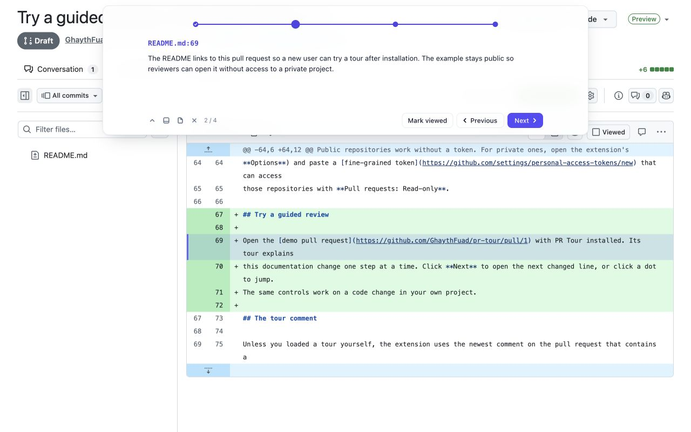

# PR Tour

[](https://github.com/GhaythFuad/pr-tour/actions/workflows/ci.yml) · [MIT license](LICENSE) · [Privacy](PRIVACY.md)

[Try the public demo](https://github.com/GhaythFuad/pr-tour/pull/1) · [Download](https://github.com/GhaythFuad/pr-tour/releases/latest)

A Chrome extension that walks you through a GitHub pull request in a planned order. The plan is a
[CodeTour](https://github.com/microsoft/codetour) tour posted as a comment on the pull request, or loaded from a file or
pasted text: a list of steps, each pointing at a file and line with notes on what to check there.



On any page of that pull request, a card at the top or bottom of the page shows the current step: a line of dots for the whole
tour, the step's file (or its title, for a step without one), its notes, and Previous and Next. The card keeps one
height; long notes scroll inside it.
A step opens its line in **Files changed** by scrolling the page; only a step opened from another tab of the pull
request loads Files changed. The tour finds the line by GitHub's link anchor for it, or by its code if GitHub stops
marking lines that way. If the line isn't on the page yet, the tour clicks **Load diff** on a large diff and scrolls
down the file until GitHub renders the line, for up to 15 seconds. Meanwhile the card says "Finding line N…";
scrolling or clicking the page yourself stops the search.
A line lands a third of the way down the part of the screen the card leaves free, so the code above it shows where it
sits; a step without a line lands its file's name there instead. GitHub keeps redrawing the page for a moment after the
jump, for example when the file you just marked Viewed collapses, so the tour holds the line in place for 2.5 seconds
or until you scroll.

- **Dots:** one per step, the larger one is where you are, and a tick means done.
- **Mark viewed** in the card ticks GitHub's own **Viewed** control for the step's file and moves on to the next step;
  click it again to untick. A step on a file is done when you mark the file
  **Viewed**; a step without a file is done once you've seen it. Hover a dot for its title, click it to jump there.
  A long tour scrolls the dots sideways and keeps the current one centered.
- **Viewed files:** Previous and Next always move exactly one step, Viewed or not. The dots refresh about a second
  after any click on the page, and when you come back to the tab. A step on a Viewed file expands it first, since
  GitHub collapses Viewed files; it stays marked Viewed. A file that changed after you viewed it counts as unviewed
  again. Reading Viewed marks needs the token below, even for public repositories.
- **Keys:** ← and → for Previous and Next, H to hide or show. They're ignored while you type or hold a modifier. Esc
  closes the load panel.
- **Dock** (bottom left, next to Hide) moves the card between the top and the bottom of the screen, and every pull
  request remembers the choice. At the bottom the card leaves GitHub's pinned file name in view.
- **Hide** (bottom left) folds the card into a small pill on its edge; click the pill to bring it back. **Close**, or
  **Finish** on the last step, removes the tour for this pull request in this tab; the extension's toolbar button
  reopens it, showing a "Loading…" pill at once. On a pull request without a tour comment the button opens the load
  panel below; on a page that isn't a pull request it says so instead.
- **Load** (bottom left, the page icon) swaps the card for a panel where you paste a tour comment or a bare `.tour`
  file, or choose the file. The loaded tour starts at step 1 and replaces the tour comment for this pull request in
  every tab, reloads included; the page icon turns the accent colour while it plays. **Use the tour comment** in the
  panel goes back to the comment; **Cancel** returns to the step you were on.

## Install

The Chrome Web Store submission is under review. Until approval, use the release download below.

Download `pr-tour-<version>-chrome.zip` from the [latest release](https://github.com/GhaythFuad/pr-tour/releases/latest),
extract it, then open `chrome://extensions` in Chrome 120 or later. Turn on **Developer mode**, choose
**Load unpacked**, and select the extracted folder that contains `manifest.json`.

For a source build, use Node.js 22 or later and pnpm 10:

```sh
git clone https://github.com/GhaythFuad/pr-tour.git
cd pr-tour
pnpm install --frozen-lockfile
pnpm build
```

Load the generated `dist/` folder as an unpacked extension. After rebuilding, click the extension's reload button
in `chrome://extensions` and reload the pull request. Keep the extension installed when updating it to retain the
token in its options.

Public repositories work without a token. For private ones, open the extension's options (right-click its icon ›
**Options**) and paste a [fine-grained token](https://github.com/settings/personal-access-tokens/new) that can access
those repositories with **Pull requests: Read-only**.

## The tour comment

Unless you loaded a tour yourself, the extension uses the newest comment on the pull request that contains a
```` ```json ```` block whose `$schema` is `https://aka.ms/codetour-schema`. Wrapping it in `<details>` keeps the conversation readable:

````markdown
<details><summary>Review tour</summary>

```json
{
  "$schema": "https://aka.ms/codetour-schema",
  "title": "Drafts and revision restore",
  "ref": "5a3a89b708da730c8762a53ccf5e909acf370e4a",
  "steps": [
    { "title": "Start here", "description": "Why this change exists and the order below." },
    {
      "title": "The contract",
      "file": "src/pages/document.ts",
      "line": 12,
      "anchor": "export type PageDocument = {",
      "description": "Where we are, what happens here and why."
    },
    {
      "title": "The check it replaces",
      "file": "src/pages/save.ts",
      "side": "old",
      "line": 40,
      "anchor": "if (draft.revision !== expected) {",
      "description": "Removed because..."
    },
    { "file": "src/pages/rename.ts", "description": "Skim: mechanical rename." }
  ]
}
```

</details>
````

| Field | Meaning |
| --- | --- |
| `title` | Tour name, the card's accessible name and the hidden pill's tooltip. |
| `ref` | The commit the tour was written against. When the pull request has changed since, a step found only by its `line` says it may have moved. |
| `steps[].description` | Markdown notes, rendered by GitHub. Required. |
| `steps[].title` | Dot label, and the heading of a step without a file. Defaults to `file:line`. |
| `steps[].file` | Path of a changed file, relative to the repository root. Omit it for intro or summary steps. |
| `steps[].line` | 1-based line number in the `side` version of the file. |
| `steps[].anchor` | That line's code, copied from the diff; leading and trailing spaces don't matter. The tour finds the line by this code wherever later commits move it, and uses `line` only to choose between repeats. |
| `steps[].side` | `new` (the default) for the file as the pull request leaves it, `old` for the file before it, which is how a step points at a deleted line. |

`ref`, `anchor` and `side` are PR Tour's additions; CodeTour ignores them, so the same JSON saved as
`.tours/<name>.tour` still plays in VS Code with the CodeTour extension (`side: "old"` steps land on whatever the new
file has at that line). A step whose code and line are both outside the diff, or whose file has no line diff, opens the
file instead, and the card says why.

## Create tours with a coding agent

The [prepare-pr-for-review skill](skills/prepare-pr-for-review/SKILL.md) teaches an agent to explain a PR in a
newcomer's reading order, point at exact diff lines, call out risks, and validate the result before posting it.
It includes a standalone checker and an optional helper to mark tests, images, lockfiles, symlinks, and unchanged
renames as Viewed for the signed-in reviewer. It works with any repository on github.com.

Install it with the [Skills CLI](https://github.com/vercel-labs/skills) (Node.js 22.20 or later):

```sh
npx skills add GhaythFuad/pr-tour --skill prepare-pr-for-review
```

Or download `pr-tour-<version>-skill.zip` from the [latest release](https://github.com/GhaythFuad/pr-tour/releases/latest)
and copy its `prepare-pr-for-review/` folder into your agent's skill directory, such as `.agents/skills/` or
`.claude/skills/` in a project. The skill needs Node.js 22 or later and an authenticated [GitHub CLI](https://cli.github.com/).
Its scripts have no npm dependencies.

Then ask your agent: “Use prepare-pr-for-review to write, check, and post a review tour for <PR URL>.” Ask it to
“draft a tour” if you only want a local file. Viewed marks are optional; they belong to the account signed into `gh`.
The skill is separate from the browser extension. Your agent and chosen model provider handle any code you send them.

To check a tour yourself from this checkout:

```sh
pnpm check-tour https://github.com/<owner>/<repo>/pull/<number> tour-comment.md
```

The file is a tour comment or a bare `.tour` file. Without it, the checker reads the newest tour comment on the PR.
It checks the current commit, changed files, unique code anchors, and old/new line numbers. It exits non-zero until
every step lands correctly. It signs in with `GITHUB_TOKEN`, or `gh auth token` when that is unset. You can also run
`node skills/prepare-pr-for-review/scripts/check-tour.mjs <PR URL> [tour file]` without installing dependencies.

## Develop

```bash
pnpm test
pnpm typecheck
```

Everything the extension knows about GitHub's Files changed page lives in `src/github-page.ts`, with tests against
saved copies of the page in `test/fixtures`. When GitHub changes the page, update the copy and that one file.


See [CONTRIBUTING.md](CONTRIBUTING.md) for the development workflow and [docs/PUBLISHING.md](docs/PUBLISHING.md) for release
and Chrome Web Store submission steps. `pnpm package` builds the extension and skill ZIPs in `release/`.

## Privacy and permissions

PR Tour communicates directly with GitHub; it has no analytics or developer-operated backend. A token is optional
for public repositories and required for private repositories and API-based Viewed progress. Step notes, including
notes from a loaded tour, are sent to GitHub's Markdown API for formatting.

The extension uses `storage` to save your optional token, `scripting` to open a tour in a GitHub tab that was already
open when the extension loaded, and access to `https://github.com/*` to display tours and navigate diffs.
Imported tours and display preferences live in GitHub page storage, which other scripts on that origin can read.
Read the [privacy policy](PRIVACY.md) for what is stored, where it goes, and how to delete it.

## License

[MIT](LICENSE). PR Tour is an independent project. It is not affiliated with GitHub, Google, or Microsoft CodeTour.
